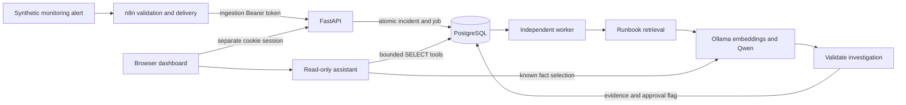
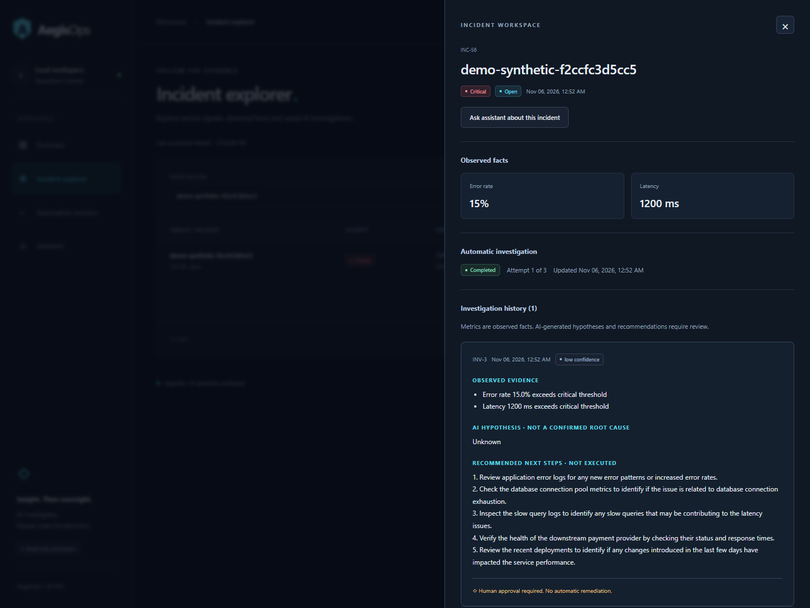

# AegisOps

A local incident investigation application that connects monitoring alerts to
durable, reviewable AI investigations. It explores how process automation and
local language models can support an operator while preserving evidence,
explicit failure states and human approval.

The v1.0.0 release candidate consolidates the existing application. It is a
demonstrable local project, not a production deployment or an autonomous
remediation system.

## Features and stack

- FastAPI and Pydantic validate authenticated incident ingestion and operator APIs.
- PostgreSQL 17, SQLAlchemy and Alembic provide incident deduplication, atomic
  job scheduling, constraints and versioned migrations.
- n8n validates and delivers alerts with bounded retries and a separate
  ingestion-only Bearer credential.
- A Python worker claims durable jobs, recovers expired leases and retries
  failures with bounded backoff.
- Ollama (`qwen2.5:3b`, `nomic-embed-text`) supplies local inference and runbook
  embeddings. RAG retrieves context from `knowledge_base/`.
- A buildless JavaScript dashboard shows filters, pagination, job states and
  saved evidence. A read-only assistant retrieves records and cites sources.
- Docker Compose runs the API, PostgreSQL and optional worker. Python 3.14.5
  was verified on Windows; the image uses `python:3.14-slim`.

## Architecture



See the [architecture walkthrough and trade-offs](docs/architecture.md).

## Screenshots



[Assistant with citations](docs/screenshots/v0.18-assistant-evidence.png) ·
[Mobile assistant](docs/screenshots/v0.18-assistant-mobile.png) ·
[Dashboard overview](docs/screenshots/v0.17-overview-desktop.png).
The v0.17/v0.18 images are historical milestone captures; the v1 image is from
the current synthetic end-to-end verification. No credentials are shown.

## Setup on a new local workstation

Install Python 3.14, Docker Desktop with Linux containers and Ollama. Node.js
is needed for JavaScript tests, not application execution. Run commands from
the repository root. Existing installations should retain their private
configuration and volumes; do not replace them with example values below.

```powershell
py -3.14 -m venv .venv
.\.venv\Scripts\python.exe -m pip install -r requirements.txt
```

Create ignored `.env` and `.env.docker` files privately. For a new Compose
installation, `.env.docker` needs the following keys; replace the password
placeholder with a strong local password, using the same value in both fields.
The checked-in Compose health check expects these database/user names.

```dotenv
DB_HOST=db
DB_PORT=5432
DB_NAME=aegisops
DB_USER=aegisops_app
DB_PASSWORD=<choose-a-local-database-password>
POSTGRES_DB=aegisops
POSTGRES_USER=aegisops_app
POSTGRES_PASSWORD=<same-local-database-password>
```

For native Python, `.env` requires `DB_HOST`, `DB_PORT`, `DB_NAME`, `DB_USER`
and `DB_PASSWORD` pointing to a separately accessible PostgreSQL instance.
Compose PostgreSQL has no published host port: native `localhost:5432` does
not connect to that container. Configure the intended database explicitly.

Generate separate API credentials and a browser password once:

```powershell
.\.venv\Scripts\python.exe -B configure_local_auth.py
.\.venv\Scripts\python.exe -B configure_dashboard.py --generate
ollama pull qwen2.5:3b
ollama pull nomic-embed-text
ollama list
```

Keep Ollama running on the host. Native default: `http://localhost:11434`;
Compose default: `http://host.docker.internal:11434`. Optional settings are
`OLLAMA_CHAT_MODEL`, `OLLAMA_EMBED_MODEL` and `DOCKER_OLLAMA_BASE_URL`.
Do not broaden network bindings to troubleshoot container connectivity.

Start a **new** Compose installation and explicitly migrate its database:

```powershell
docker compose build api worker
docker compose up -d db
docker compose run --rm api python -m alembic upgrade head
docker compose --profile worker up -d api worker
docker compose ps
```

Neither API nor worker applies migrations automatically. Current Alembic head
is `d150b8e2a731`. Existing installations should inspect their revision before
applying migrations; never run `docker compose down -v` to refresh a demo.

Open [dashboard](http://127.0.0.1:8001/dashboard) and use the password stored
privately in `.env.dashboard-login`. Assistant is a dashboard view and uses
that session, not a browser API token. API docs are at
[localhost /docs](http://127.0.0.1:8001/docs).

For a native installation with PostgreSQL already configured and migrated:

```powershell
.\.venv\Scripts\python.exe -B -m alembic upgrade head
# Separate terminals; port 8001 must be free:
.\.venv\Scripts\python.exe -B -m uvicorn app:app --host 127.0.0.1 --port 8001
.\.venv\Scripts\python.exe -B -m worker
```

## n8n and example interactions

n8n is managed separately from this Compose project. On a fresh instance,
publish its editor only on `127.0.0.1:5678`, retain its data volume and
encryption key, and import `workflows/aegisops-v0.16.0.json`. In **Ingest
incident**, select a **Header Auth** credential: name `Authorization`, value
`Bearer ` followed by the private `AEGISOPS_N8N_TOKEN`. Never put this token
in workflow JSON. Set the API URL to
`http://host.docker.internal:8001/incidents` when n8n runs in Docker on this
Windows layout. Publish/activate the workflow; importing alone leaves it inactive.
Do not reimport or modify unrelated workflows on an existing installation.
Detailed [n8n import, credentials and networking](docs/v0.16.0-secure-n8n.md).

```powershell
$service = 'demo-synthetic-' + [guid]::NewGuid().ToString('N').Substring(0,12)
$payload = @{service=$service; error_rate=15; latency=1200} | ConvertTo-Json
$url = 'http://127.0.0.1:5678/webhook/aegisops-v016-alert'
Invoke-RestMethod -Method Post -Uri $url -ContentType application/json -Body $payload
Invoke-RestMethod -Method Post -Uri $url -ContentType application/json -Body $payload
```

Expect `api_status: 201`, then `200`, with the same `incident_id`. These are
the downstream FastAPI statuses exposed by the workflow response. The API
creates one open incident and one automatic job for a new service. Operator
Bearer routes include `GET /incidents/{id}/investigation-job` and
`GET /incidents/{id}/investigations`. Keep credentials out of command history
and use the dashboard for a credential-free presentation.

## Tests and verified results

Tests require a separate `aegisops_test` PostgreSQL database accessible through
the native `.env` host/user/password. A database administrator must create it
and grant the test role CONNECT and CREATE on **that test database**. Tests
create random schemas there, migrate them and drop only their own schemas.
The configured application database must differ. Do not run root-level
historical scripts such as `atomicity_test.py` against application data.

```powershell
.\.venv\Scripts\python.exe -B -m pytest -p no:cacheprovider tests --ignore=tests/test_metrics_agent.py -q
node --test tests/dashboard_frontend.mjs
.\.venv\Scripts\python.exe -m pip check
.\.venv\Scripts\python.exe -B scripts/check_release_secrets.py
git diff --check
```

On the verified local checkout: **156 passed, 0 failed, 2 skipped** for tracked
Python tests; both optional real-model tests passed separately (**2 passed**);
frontend tests: **6 passed, 0 failed, 0 skipped**. The unrelated local metrics
experiment was tested separately (**3 passed**) and is excluded from release
scope. The final complete local rerun including that experiment was
**159 passed, 0 failed, 2 skipped**. See [release verification](docs/release-verification.md) for exact scope,
clean-start evidence and limitations. No performance guarantee is implied.

## Security, reliability and limits

API ingestion and operator Bearer roles are separate. Dashboard login uses
a separate scrypt password hash and expiring HttpOnly, SameSite=Strict
cookie. Same-origin checks, CSRF checks, strict CSP and text-node rendering
protect browser interactions. The assistant only uses bounded allowlisted
read tools; Qwen selects known fact IDs and cannot execute SQL or remediation.
Model-selection failure produces an explicit degraded facts response.

PostgreSQL enforces one open incident per service and one initial automatic
job per incident. Scheduling commits atomically with ingestion; lease claims,
bounded retries and transaction checks protect worker recovery. This is
deduplication while an incident is open, not durable event-ID idempotency.

AI hypotheses and runbook suggestions can be incorrect or irrelevant. The
current synthetic result correctly retained an Unknown cause; some suggested
checks came from generic runbooks and do not establish service-specific facts.
Human approval is saved and displayed; actions are never executed. This local
HTTP, single-process, shared-password setup has no multi-user identity system,
public webhook authentication/rate limiting or production deployment guarantees.
Session state is lost on API restart. Upstream inference lacks hard cancellation.
Dependency pins and base-image tags lack content hashes/digests.

Future work could add event identities, retrieval quality evaluation, migration
and backup automation, shared sessions and deployment hardening. Those are
outside this release. Use the [technical demonstration guide](docs/interview-demo.md)
for a repeatable 3–5 minute walkthrough and recovery steps.
