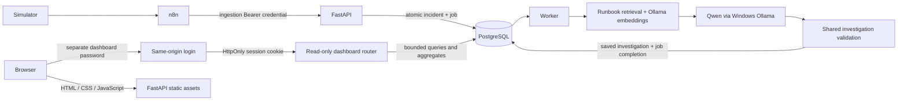

# AegisOps architecture

AegisOps runs locally: FastAPI serves the API and buildless dashboard on
`127.0.0.1:8001`. PostgreSQL stays on the Compose network. The existing n8n
container publishes only `127.0.0.1:5678`. One independent worker uses the
durable PostgreSQL queue and Windows Ollama through
`host.docker.internal:11434`. No public service, broker, frontend runtime, or autonomous-agent framework
is added.

`app.py` includes the new dashboard routers without changing v0.16's Bearer
authorization dependencies or ingestion/worker contracts. `dashboard_auth.py`
owns local browser sessions; `dashboard_api.py` owns bounded read-only
queries and response schemas. `frontend/` renders those responses using
DOM text nodes and polls visible views every eight seconds. The operations views never create jobs, modify incidents or execute
remediation. The Assistant view adds bounded model-based evidence selection
through a separate session/CSRF-protected router; it never initiates an
investigation or mutates application records.

Authentication boundaries are intentionally separate. n8n uses the existing
ingestion-only token. Trusted non-browser operators retain their existing
API token. The browser receives neither token: it authenticates with a
separate password against a salted scrypt hash, then receives a one-hour
opaque, HttpOnly, SameSite=Strict cookie scoped to `/dashboard`. Origin and
Host checks protect login; logout also requires a session-bound CSRF token.
Browser cookies do not authorize any existing Bearer API route.

Sessions and login throttles are process-local and bounded. API restart
revokes sessions. This MVP uses one API process and trusted local HTTP;
an external deployment would need HTTPS, Secure cookies, shared sessions,
identity/access design and deployment hardening beyond this milestone.

No schema change or Alembic migration is needed. Dashboard aggregate counts
are computed in PostgreSQL; paginated lists return at most 100 incidents or
jobs, and history at most 50 investigations. Detail requests are scoped to
one incident. Legacy incidents without automatic jobs remain valid.
Pagination uses deterministic ordering with an offset, which can shift
under concurrent ingestion. Filters and pagination remain in browser memory.

The dashboard shows AegisOps job state, not n8n execution history. Observed
metrics and validated evidence are presented separately from AI hypotheses
and suggested actions. Human approval requirements remain visible and no
action buttons bypass that boundary.

See [dashboard operations](v0.17.0-dashboard.md),
[secure n8n integration](v0.16.0-secure-n8n.md), and
[durable worker design](v0.15.0-durable-investigations.md).

## Read-only assistant (v0.18.0)

`assistant_api.py` stores six conversation turns on the existing dashboard
session. Its POST/clear endpoints reuse the same-origin CSRF dependency;
GET reads only that session's history. No conversation table is added.
`assistant_tools.py` exposes five typed, bounded SELECT/RAG capabilities:
list incidents, get an incident, get saved investigations, get its automatic
job, and search existing runbooks. Authorization is checked at dispatch.

`assistant_service.py` determines the retrieval plan on the server, calls at
most four tools and gives Qwen a fact registry. The model returns only a
schema-constrained selection of known fact IDs. The server builds factual
text and citation links from retrieved data, rejects fabricated references,
and retains required unknown/missing-evidence notices. This is extractive
reasoning with no arbitrary SQL, file/URL access, shell or remediation.

`frontend/assistant.js` renders session messages and facts using text nodes.
Incident/investigation citations open the existing detail dialog; runbooks
show actual filenames and quoted passages. Model failure produces an explicit
verified-facts fallback. No database transaction remains open during model
selection. The original ingestion, queue and worker paths are unchanged.

See [assistant design, verification and limits](v0.18.0-assistant.md).

## Component responsibilities and trade-offs

| Component | Why it exists | Trade-off |
| --- | --- | --- |
| n8n | Visual webhook validation, credentials and delivery retries | Another service to configure; it does not own incident/job identity. |
| FastAPI | Typed contracts, authorization and atomic incident/job creation | Explicit validation and backward compatibility need regression coverage. |
| PostgreSQL | Durable incident, job and evidence state; uniqueness and claim transactions | Queue operations share database capacity; migrations and backups remain operator responsibilities. |
| Worker | Runs slow inference outside ingestion and recovers expired claims | Lease sizing, retry budgets and stale-claim checks require care; inference can repeat after failure. |
| RAG | Supplies actual local runbook passages instead of relying only on model memory | Similarity is not correctness; a synthetic unfamiliar service can retrieve generic or irrelevant advice. |
| Ollama/Qwen | Keeps model requests local and selects/generates bounded structured output | Model availability, hardware and output quality vary; there is no latency guarantee. |
| Dashboard/assistant | Presents saved state, source references and approval requirements | Shared-password/process-local sessions suit this local demonstration, not multi-user production use. |

An incident and its initial job commit together, before inference. The partial
unique index prevents two open incidents for the same service; the job's
unique incident/trigger constraint prevents duplicate initial jobs. Delivery
retries therefore do not require an external broker for this local scale.
This does not establish event identity after incident closure or exactly-once
model execution. Worker result/claim checks protect durable state even when
an inference attempt is retried.

The investigator generates hypotheses and recommendations from metrics and
retrieved context, then validates the result before saving it. The assistant
has a different contract: its model selects existing fact IDs and the server
assembles cited text. Neither path proves root cause. Unknown causes and
human approval are legitimate outcomes, not errors to hide in a demonstration.

The v1.0.0 candidate changes documentation, verification helpers, a browser
test selector and Docker build-context exclusions. It adds no application
feature, migration, role, model or workflow. See the
[release verification](release-verification.md) and
[technical demonstration guide](interview-demo.md).
