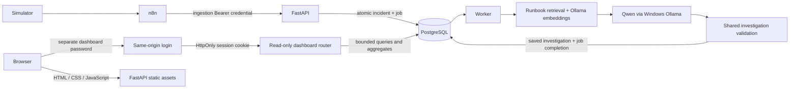

# AegisOps architecture — v0.17.0

AegisOps runs locally: FastAPI serves the API and buildless dashboard on
`127.0.0.1:8001`. PostgreSQL stays on the Compose network. The existing n8n
container publishes only `127.0.0.1:5678`. One independent worker uses the
durable PostgreSQL queue and Windows Ollama through
`host.docker.internal:11434`. No public service, broker, frontend runtime,
or conversational assistant is added.

`app.py` includes the new dashboard routers without changing v0.16's Bearer
authorization dependencies or ingestion/worker contracts. `dashboard_auth.py`
owns local browser sessions; `dashboard_api.py` owns bounded read-only
queries and response schemas. `frontend/` renders those responses using
DOM text nodes and polls visible views every eight seconds. The dashboard
never invokes model inference, creates a job, modifies an incident, or
executes remediation.

Authentication boundaries are intentionally separate. n8n uses the existing
ingestion-only token. Trusted non-browser operators retain their existing
API token. The browser receives neither token: it authenticates with a
separate password against a salted scrypt hash, then receives a one-hour
opaque, HttpOnly, SameSite=Strict cookie scoped to `/dashboard`. Origin and
Host checks protect login; logout also requires a session-bound CSRF token.
Browser cookies do not authorize any existing Bearer API route.

Sessions and login throttles are process-local and bounded. API restart
revokes sessions. This MVP uses one API process and trusted local HTTP;
an external deployment would need HTTPS, Secure cookies, shared sessions,
identity/access design and deployment hardening beyond this milestone.

No schema change or Alembic migration is needed. Dashboard aggregate counts
are computed in PostgreSQL; paginated lists return at most 100 incidents or
jobs, and history at most 50 investigations. Detail requests are scoped to
one incident. Legacy incidents without automatic jobs remain valid.
Pagination uses deterministic ordering with an offset, which can shift
under concurrent ingestion. Filters and pagination remain in browser memory.

The dashboard shows AegisOps job state, not n8n execution history. Observed
metrics and validated evidence are presented separately from AI hypotheses
and suggested actions. Human approval requirements remain visible and no
action buttons bypass that boundary.

See [dashboard operations](v0.17.0-dashboard.md),
[secure n8n integration](v0.16.0-secure-n8n.md), and
[durable worker design](v0.15.0-durable-investigations.md).
